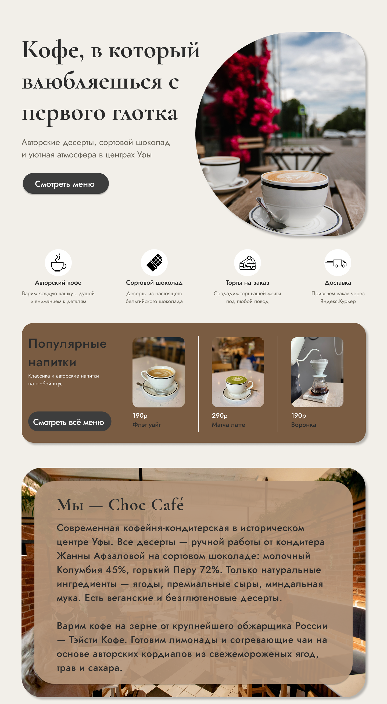
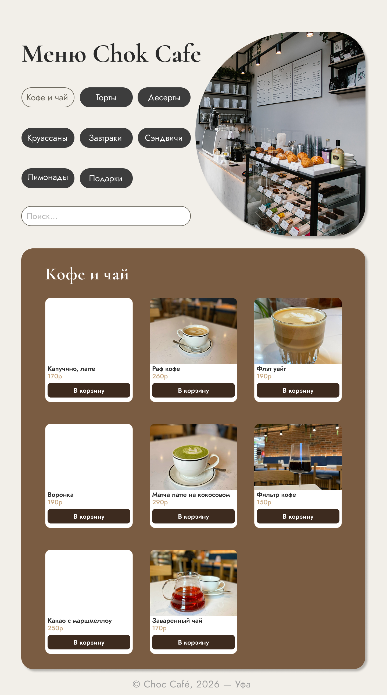
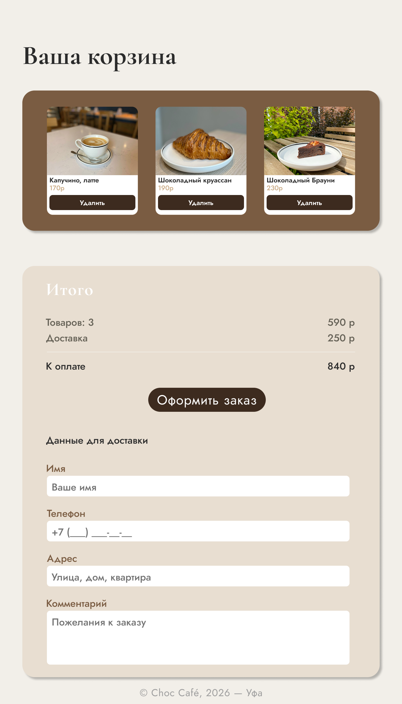
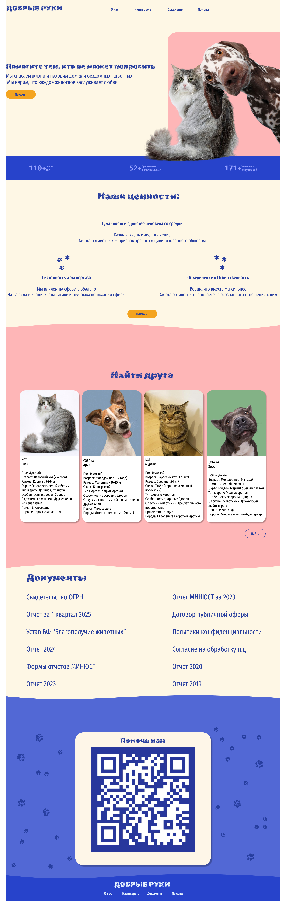

# Резюме

- [Хуснутдинова Камила](https://rechieone.github.io/college-portfolio/portfolio/index.html)

# college-portfolio

Практические задания по UI-разработке, выполненные в рамках обучения в колледже.

## Работы

- [Практика 2 — квиз](https://rechieone.github.io/college-portfolio/ui-development-practice-2/qiz.html)
- [Практика 8 — сайт «Бинго Бонго»](https://rechieone.github.io/college-portfolio/ui-development-practice-8/Bingo/main.html)
- [Практика 9 — сайт с уроками и тестами](https://rechieone.github.io/college-portfolio/ui-development-practice-9/glavn9.html)
- [Практика 10 — сайт с портфолио и контактами](https://rechieone.github.io/college-portfolio/ui-development-practice-10/)

## Веб-приложения

### Зоопарк Admin — админ-панель на PHP и MySQL

Учебный проект по базам данных: управление комплексами, вольерами и размещением животных. Часть правил реализована в самой базе данных с помощью триггеров: в вольере не больше 3 животных, хищников нельзя селить с травоядными, суточная норма корма должна быть больше 0, а количество животных в вольере считается автоматически.

Проект запускается только локально (нужен XAMPP), так как GitHub Pages не выполняет PHP. Файлы, дамп базы и инструкция по запуску: [php-zoo-admin](https://github.com/rechieone/college-portfolio/tree/main/php-zoo-admin).

## Дизайн-проекты

Логотипы, постеры и другие работы по графическому дизайну.

[Открыть портфолио на Google Диске](https://drive.google.com/drive/folders/1-_jVdVqfSzxRswT6qFA9BgOaYqdLZKc4?usp=sharing)

### Choc Café — сайт кофейни-кондитерской (Tilda)

Учебный дизайн-проект: показываю работу с композицией, цветом и типографикой. Сайт собран в конструкторе Tilda, без программирования. Не является сайтом реального заведения.

[Открыть сайт](https://choccafe.tilda.ws)

### Добрые руки — сайт помощи бездомным животным (Figma)

Учебный макет в Figma: показываю работу с сеткой, цветом и типографикой.

## Технологии

HTML, CSS, PHP, MySQL, Tilda (для дизайн-проектов), Figma

## Контакты

- Email: kammlahusnutdinova@gmail.com
